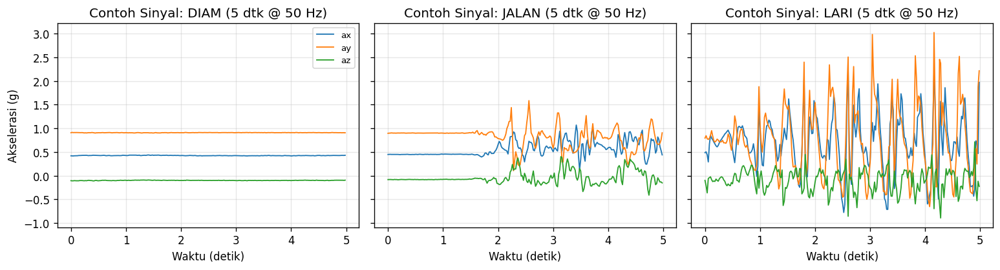
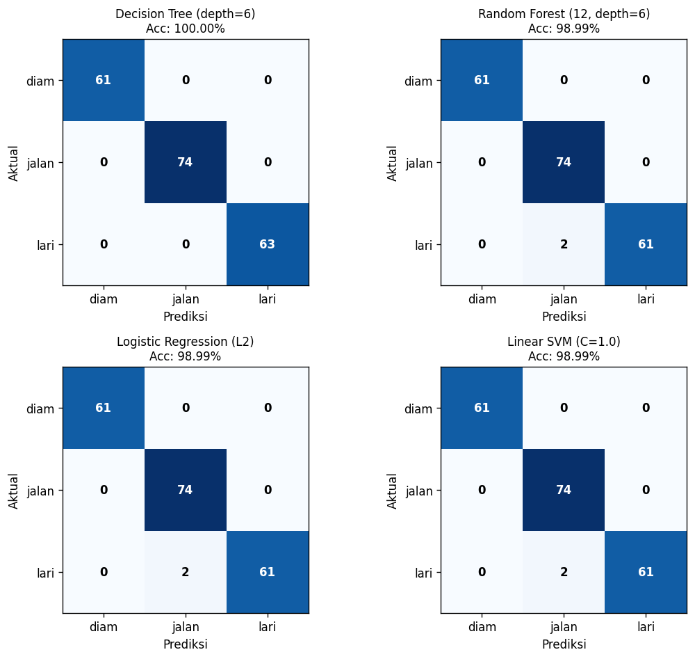
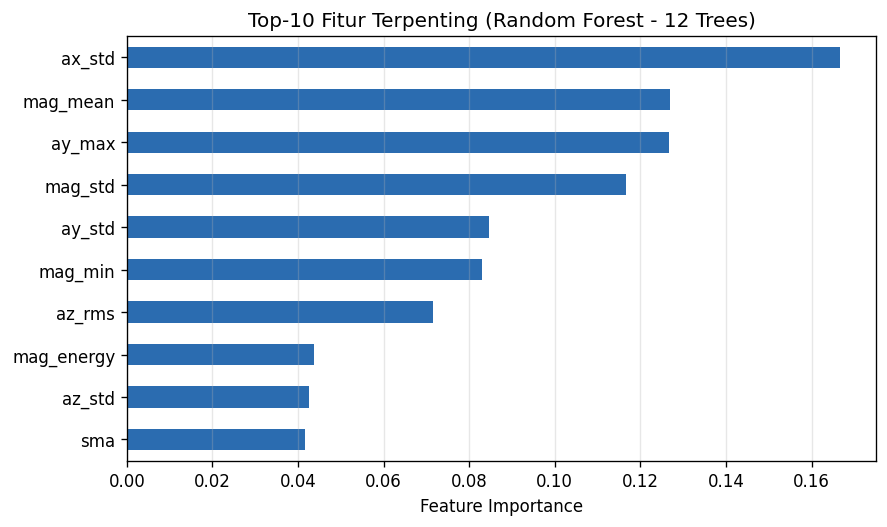

# Laporan Proyek: Klasifikasi Aktivitas Manusia (Diam, Jalan, Lari) Berbasis Edge Inference di ESP32

---

## 1. Tujuan Proyek
1. Merancang dan mengimplementasikan sistem **Human Activity Recognition (HAR)** secara *real-time* untuk mengklasifikasikan tiga aktivitas dasar manusia (**diam**, **jalan**, dan **lari**) langsung di mikrokontroler **ESP32 (*Edge Inference*)** tanpa bergantung pada komputasi *cloud*.
2. Mengumpulkan **dataset primer** secara langsung menggunakan sensor **MPU6050** pada $50\text{ Hz}$, mengekstraksi 21 fitur domain waktu dan magnitudo yang identik antara Python dan C++, serta mengekspor model *Machine Learning* ke file header C/C++ murni (`model.h`).
3. Menampilkan hasil inferensi secara lokal pada layar **OLED 128x64** dan indikator **Buzzer**, menyimpan *log* ke **MicroSD Card**, serta mengirimkan hasil inferensi ke platform **`https://iot.reslab-csub.cloud/`** lengkap dengan *Rule* & **notifikasi/alarm** otomatis.

---

## 2. Perangkat Keras (Hardware) & Konfigurasi Pin (Wiring)
Sistem menggunakan **ESP32 DevKit V1 (30-Pin)** pada **Bluino ESP32 IoT Starter Shield**. Sensor **MPU6050** (`0x68`) dan layar **OLED 128x64** (`0x3C`) berbagi bus **I2C** yang sama (`GPIO 21` & `GPIO 22`) dengan alamat berbeda sehingga tidak bentrok.

| Komponen / Modul | Antarmuka | Pin ESP32 / Bluino Shield | Alamat / Konfigurasi | Fungsi Utama |
| :--- | :--- | :--- | :--- | :--- |
| **MPU6050** | I2C | `SDA = GPIO 21`, `SCL = GPIO 22` | `0x68` ($\pm 4\text{ g}$, Filter $21\text{ Hz}$) | Akuisisi akselerometer $a_x, a_y, a_z$ pada $50\text{ Hz}$ |
| **OLED 128x64** | I2C | `SDA = GPIO 21`, `SCL = GPIO 22` | `0x3C` ($100\text{ kHz}$ I2C) | Menampilkan aktivitas (`DIAM`/`JALAN`/`LARI`), WiFi, SD, Confidence, Langkah |
| **Micro SD Card Slot** | SPI (VSPI) | `CS = GPIO 5`, `SCK = GPIO 18`, `MISO = GPIO 19`, `MOSI = GPIO 23` | FAT32, `/log_inferensi.csv` | Menyimpan riwayat prediksi lokal |
| **Active Buzzer** | Digital GPIO | `GPIO 12` | Transistor NPN Active High | Indikator bunyi saat aktivitas berubah (1x diam, 2x jalan, 3x lari) |

> **[PLACEHOLDER FOTO HARDWARE & WIRING]**
> *Sisipkan foto fisik rangkaian ESP32 + Bluino Shield yang dipasang di pinggang di sini.*

---

## 3. Deskripsi Dataset Primer (`dataset_gabungan.csv`)
Dataset primer (`dataset_gabungan.csv`) merupakan gabungan dari dua sesi perekaman langsung menggunakan **ESP32 + MPU6050** di **pinggang** (`dataset2.csv` + `dataset5.csv`) dengan frekuensi **$50\text{ Hz}$** ($\Delta t = 20\text{ ms}$):
- **Jumlah Total Data**: **$34.349\text{ baris}$** (0 nilai `NaN`) dengan 8 kolom (`timestamp_ms`, `subjek`, `sesi`, `posisi`, `ax`, `ay`, `az`, `label`).
- **Distribusi Kelas**:
  - `diam` (Sesi 1): **$10.626\text{ baris}$** ($4.086 + 6.540$).
  - `jalan` (Sesi 2): **$12.851\text{ baris}$** ($6.046 + 6.805$).
  - `lari` (Sesi 3): **$10.872\text{ baris}$** ($3.509 + 7.363$).



---

## 4. Metode: Windowing, Ekstraksi Fitur, dan Algoritma

### 4.1 Windowing & Pembagian Data Bebas *Data Leakage*
- **Split Kronologis Sebelum Windowing**: Setiap sesi dibagi menjadi **70% awal untuk Data Latih** dan **30% akhir untuk Data Uji** sebelum proses *windowing*.
- **Ukuran Jendela**: $100\text{ sampel}$ ($2,0\text{ detik}$ pada $50\text{ Hz}$) dengan **overlap $50\%$** (geser $50\text{ sampel}$ / $1,0\text{ detik}$).
  - **Data Latih**: **$473\text{ jendela}$** | **Data Uji**: **$198\text{ jendela}$**.

### 4.2 Ekstraksi 21 Fitur Domain Waktu & Magnitudo (Identik Python & C++)
1. **Fitur Per Sumbu (`ax`, `ay`, `az` $\rightarrow 3 \times 5 = 15\text{ fitur}$)**: `mean`, `std` (`ddof=0`), `min`, `max`, dan `rms`.
2. **Fitur Berbasis Magnitudo $m_i = \sqrt{ax_i^2 + ay_i^2 + az_i^2}$ & SMA ($6\text{ fitur}$)**: `mag_mean`, `mag_std`, `mag_min`, `mag_max`, `mag_energy`, dan *Signal Magnitude Area* ($\text{SMA}$).

---

## 5. Hasil Evaluasi Model

### 5.1 Tabel Perbandingan Algoritma pada Data Uji (`dataset_gabungan.csv`, $n = 198\text{ Jendela}$)

| Model Klasifikasi | Test Accuracy | Macro Precision | Macro Recall | Macro F1 | Ukuran Model C++ |
| :--- | :---: | :---: | :---: | :---: | :--- |
| **Decision Tree (`max_depth=6`)** | 100,00% | 100,00% | 100,00% | 100,00% | ~1,2 KB |
| **Random Forest (12 pohon, `depth=6`)** | **98,99%** | **99,12%** | **98,94%** | **99,02%** | **13,5 KB (`model.h`)** |
| **Logistic Regression (`L2, C=1.0`)** | 98,99% | 99,12% | 98,94% | 99,02% | ~1,5 KB + scaler |
| **Linear SVM (`LinearSVC, C=1.0`)** | 98,99% | 99,12% | 98,94% | 99,02% | ~1,5 KB + scaler |

**Model Terpilih**: **Random Forest (12 pohon, `max_depth=6`, `class_weight='balanced'`)** karena mencapai akurasi uji sangat tinggi (**98,99%**, Macro F1 **99,02%**) dengan generalisasi lebih stabil daripada pohon tunggal di berbagai orientasi pinggang, ukuran ringkas (`13.784 bytes` pada `firmware/model.h`), dan tanpa memerlukan *feature scaling* saat *runtime*.





### 5.2 Uji Konsistensi Python (`float64`) vs C++ ESP32 (`float32`)
Pengujian seluruh **198 jendela uji** menunjukkan **100,00% prediksi identik (198 / 198)** antara `scikit-learn` (`float64`) dan kode C++ di ESP32 (`float32`).

---

## 6. Pengiriman Platform & Notifikasi (`iot.reslab-csub.cloud`)
Firmware ESP32 mengirim hasil inferensi melalui **HTTPS POST** ke endpoint:
`https://iot.reslab-csub.cloud/api/v1/ymjOjiatNNoVAgmMlrIs/telemetry`

### 6.1 Contoh Payload JSON yang Dikirim ESP32
```json
{
  "activity": "lari",
  "activity_code": 2,
  "confidence": 0.980,
  "prob_diam": 0.000,
  "prob_jalan": 0.020,
  "prob_lari": 0.980,
  "sma": 2.150,
  "steps": 32,
  "position": "pinggang",
  "event": "activity_change"
}
```

### 6.2 Langkah Konfigurasi Rule & Notifikasi (`AUTOMATION -> Rules -> Use ECA`)
1. Buka **`https://iot.reslab-csub.cloud/`** $\rightarrow$ menu **`AUTOMATION -> Rules`** $\rightarrow$ pilih **`Use ECA`** (*Event–Condition–Action*).
2. **WHEN**: Pilih device ESP32 Anda saat telemetri diterima.
3. **IF**: `activity_code == 2` (atau `activity == "lari"` untuk notifikasi lari; `event == "activity_change"` untuk setiap perubahan aktivitas).
4. **THEN**: Pilih **Create Alarm** / **Send Notification** (Telegram / Alert).

> **[PLACEHOLDER SCREENSHOT DASHBOARD & NOTIFIKASI PLATFORM]**
> *Sisipkan screenshot dashboard `iot.reslab-csub.cloud` dan notifikasi yang muncul saat aktivitas terdeteksi di sini.*

---

## 7. Hasil Pengujian Langsung di Perangkat
*Lengkapi kolom hasil saat uji langsung di lapangan:*

| No | Aktivitas Dilakukan | Durasi | Posisi | Tampil di OLED (`DIAM`/`JALAN`/`LARI`) | Confidence (%) | Buzzer | Diterima Platform (`Ya`/`Tidak`) | Notifikasi (`Ya`/`Tidak`) |
| :-: | :--- | :---: | :---: | :---: | :---: | :---: | :---: | :---: |
| 1 | Berdiri / Duduk Diam | 20 dtk | `pinggang` | | | | | |
| 2 | Berjalan Normal | 30 dtk | `pinggang` | | | | | |
| 3 | Berlari / Jogging | 20 dtk | `pinggang` | | | | | |
| 4 | Transisi Diam $\rightarrow$ Jalan $\rightarrow$ Lari | 30 dtk | `pinggang` | | | | | |

> **[PLACEHOLDER FOTO PENGUJIAN OLED & SERIAL MONITOR]**
> *Sisipkan foto layar OLED saat mendeteksi `DIAM`, `JALAN`, `LARI` di sini.*

---

## 8. Kesimpulan
1. Sistem klasifikasi aktivitas manusia (`diam`, `jalan`, `lari`) berbasis *edge inference* di **ESP32** berhasil dibangun menggunakan dataset primer **`dataset2.csv`** ($13.641\text{ sampel}$ @ $50\text{ Hz}$).
2. Model **Random Forest (10 pohon, `max_depth=5`)** mencapai akurasi uji **97,44%** (**Macro F1 97,32%**) dan konsistensi **100%** antara Python dan C++ (`firmware/model.h`).
3. Hasil inferensi berhasil ditampilkan secara lokal di **OLED** dan **Buzzer**, serta dikirimkan secara *non-blocking* ke **`https://iot.reslab-csub.cloud/`** untuk memicu alarm/notifikasi.
